<div align="center">


# Chromecast Web

**Trasmetti dirette, playlist IPTV e video dal web sulla TV — da qualsiasi telefono della rete di casa.**

Un'app web self-hosted (FastAPI + Next.js) che trasforma qualunque browser in un telecomando completo per il
Chromecast, con un browser remoto integrato che trova da solo il video dentro le pagine web.

[](https://github.com/Filpin011/Chromecast-Web/actions/workflows/ci.yml)
[](https://github.com/Filpin011/Chromecast-Web/actions/workflows/codeql.yml)
[](https://github.com/Filpin011/Chromecast-Web/releases)
[](LICENSE)
[](https://github.com/Filpin011/Chromecast-Web/pkgs/container/chromecast-web)

🇬🇧 [English](README.md)

</div>

> [!IMPORTANT]
> **Progetto indipendente e non ufficiale.** Non è affiliato, approvato né supportato da Google. "Chromecast" e
> "Google Cast" sono marchi di Google LLC, citati solo per indicare i dispositivi compatibili ([DISCLAIMER.md](DISCLAIMER.md)).
> **Solo LAN / VPN, nessuna autenticazione**: non esporlo mai su Internet ([SECURITY.md](SECURITY.md)).

<p align="center">
  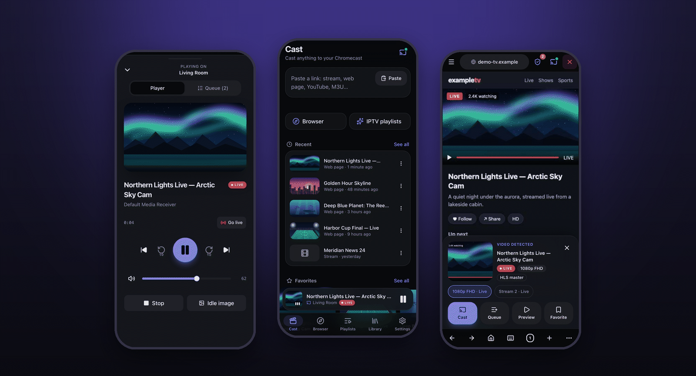
</p>

## Indice

[Funzionalità](#funzionalità) · [Screenshot](#screenshot) · [Come funziona](#come-funziona) ·
[Avvio rapido](#avvio-rapido) · [Configurazione](#configurazione) · [Consigli d'uso](#consigli-duso) ·
[Sicurezza](#sicurezza) · [Problemi comuni](#faq--problemi-comuni) · [Limiti](#limiti-noti) · [Sviluppo](#sviluppo) ·
[Ringraziamenti](#ringraziamenti)

## Funzionalità

**Trasmetti quasi tutto**
- Link diretti: HLS (`.m3u8`), DASH (`.mpd`), MP4, MKV, MPEG-TS, in diretta o on demand.
- **Pagine web** con un video dentro: aperte in un Chromium vero sul server (JavaScript, iframe annidati, click su
  "play") e lo stream viene intercettato a livello di rete.
- **Playlist IPTV / M3U**: import da URL o file, gruppi, ricerca, migliaia di canali, header per canale.
- **YouTube e molti altri siti** tramite [yt-dlp](https://github.com/yt-dlp/yt-dlp).
- **File locali** da una cartella del server, con i loro sottotitoli `.srt` / `.vtt`.

**Browser remoto**
- Navighi qualsiasi sito dal telefono: tap, scroll, tastiera. Gli stream trovati compaiono in un pannello con
  anteprima, qualità (*1080p FHD*) e badge *Live* — **Trasmetti**, **Coda**, **Anteprima** o **Preferito** con un tap.
- **Blocco pubblicità come uBlock Origin**: motore `adblock` di Brave con le liste predefinite di uBO, filtri
  cosmetici, interruttore per sito e contatore delle richieste bloccate.
- **Popup trattenuti**: *"La pagina vuole aprire …"* → Apri / Blocca / Blocca sempre. Un tap sulla × chiude tutto.

**Un vero telecomando**
- Play/pausa, seek, ±10 s, *Vai al live*, volume, sottotitoli e tracce audio, precedente/successivo.
- **Coda** lato server (riordina, rimuovi), **preferiti**, **cronologia**, **immagine di attesa** sulla TV.
- Tutti i telefoni, tablet e PC aperti restano **sincronizzati in tempo reale** via WebSocket.

**Riproduce ciò che il Chromecast non legge**
- **Proxy** integrato per gli stream che richiedono Referer, Cookie, User-Agent o header CORS.
- **Restream FFmpeg** per TS grezzo, RTMP/RTSP/UDP, AVI, FLV, WMV…; il video non H.264 viene ricodificato al volo.

**Fatto per la casa**
- **PWA** installabile, tema scuro e chiaro, inglese e italiano.
- Scoperta automatica (mDNS) o **aggiunta del dispositivo per IP**; un'unica immagine Docker multi-arch
  (`amd64`, `arm64`).

## Screenshot

<table>
  <tr>
    <td align="center">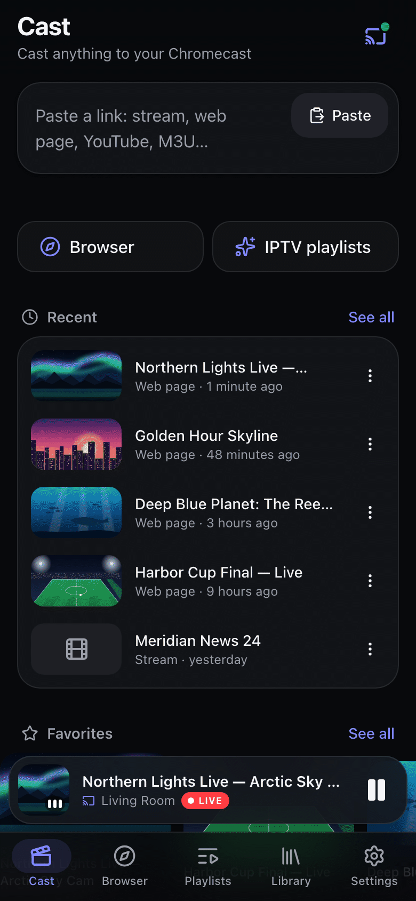<br><sub>Home</sub></td>
    <td align="center">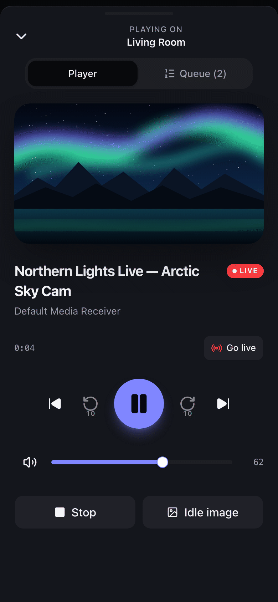<br><sub>In riproduzione</sub></td>
    <td align="center">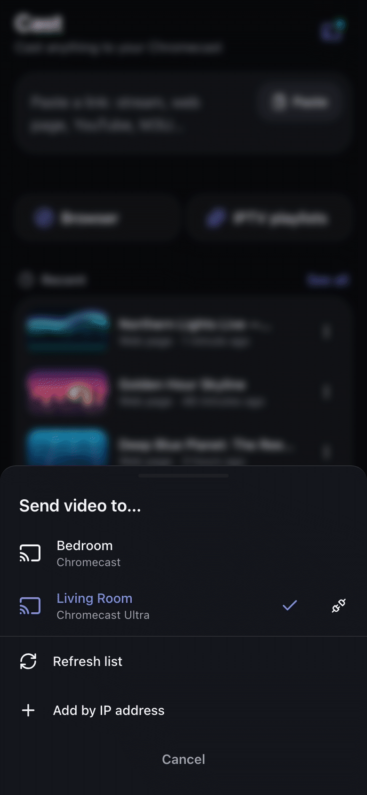<br><sub>Invia video a…</sub></td>
    <td align="center">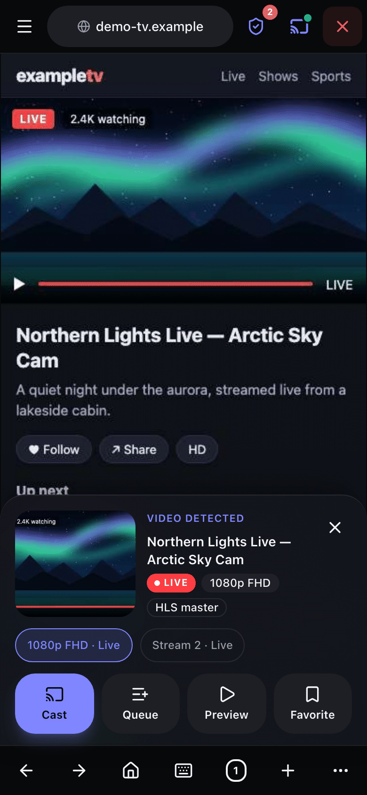<br><sub>Browser remoto: video rilevato</sub></td>
  </tr>
  <tr>
    <td align="center">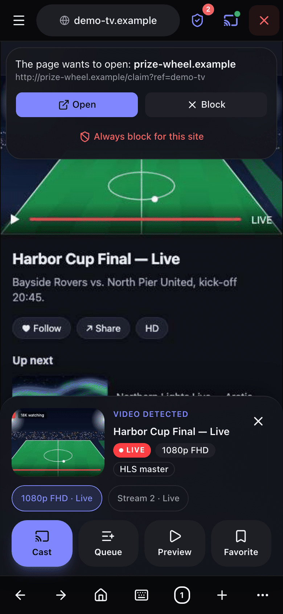<br><sub>Popup trattenuto</sub></td>
    <td align="center">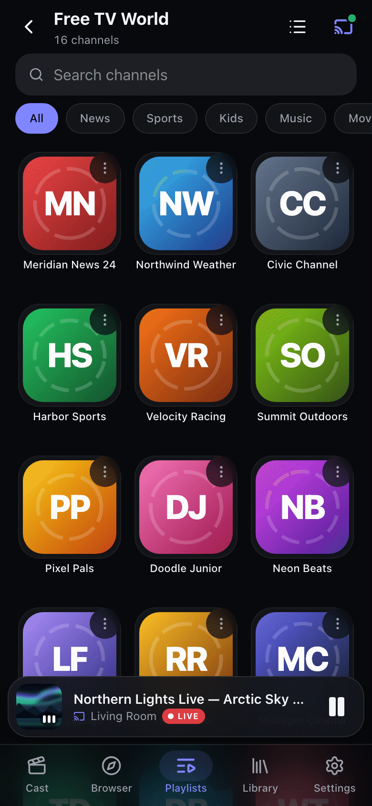<br><sub>Canali IPTV</sub></td>
    <td align="center">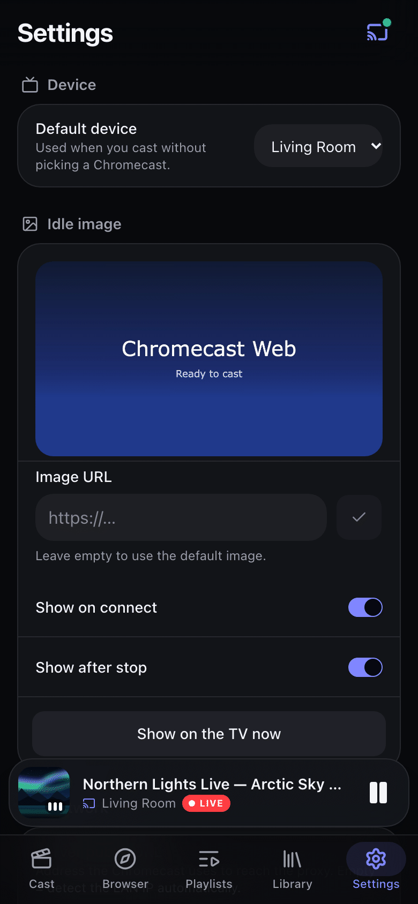<br><sub>Impostazioni</sub></td>
    <td align="center">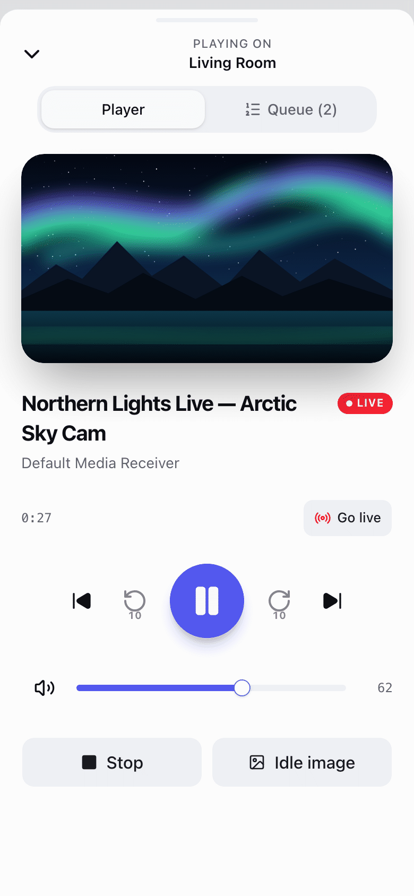<br><sub>Tema chiaro</sub></td>
  </tr>
</table>

<details>
<summary><b>Desktop</b></summary>

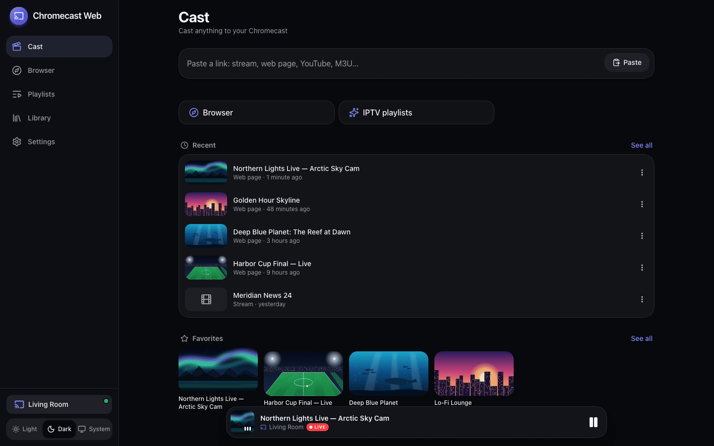
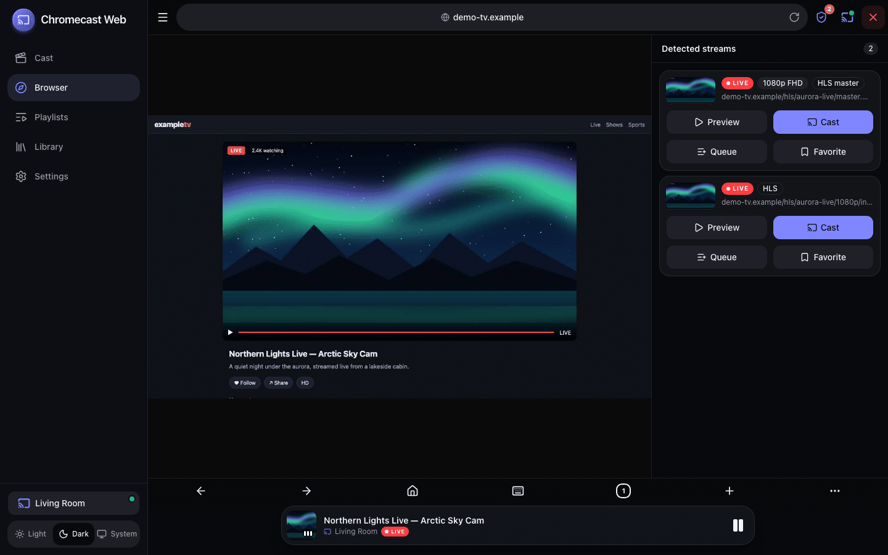

</details>

<sub>Gli screenshot (interfaccia in inglese, la lingua predefinita) usano dati demo inventati (canali di fantasia,
grafica originale) generati da `make screenshots`.</sub>

## Come funziona

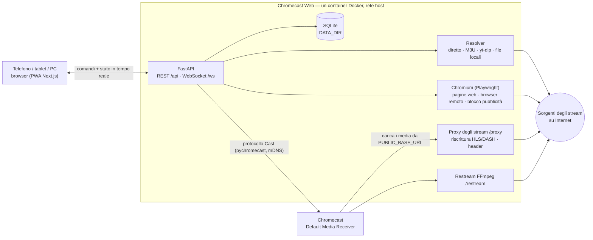

1. Il telefono parla solo con il server (REST per i comandi, un WebSocket che invia ogni cambio di stato).
2. Il server trasforma ciò che incolli in uno stream riproducibile: direttamente, con yt-dlp, leggendo una M3U
   oppure aprendo la pagina in Chromium e osservandone il traffico di rete.
3. Dice al Chromecast cosa caricare. Se lo stream richiede header, ha problemi di CORS o usa un formato che il
   Chromecast non legge, il Chromecast lo scarica **dal server** (`/proxy` o `/restream`): per questo il server deve
   essere raggiungibile dal Chromecast sulla LAN.

Il contratto completo (modelli, endpoint, messaggi WebSocket) è in [`docs/ARCHITECTURE.md`](docs/ARCHITECTURE.md).

## Avvio rapido

> **Requisito:** server e Chromecast devono stare sulla **stessa LAN**. La scoperta mDNS non attraversa la rete
> bridge di Docker e il Chromecast deve poter aprire `http://<ip-del-server>:8000/proxy/…`.

### Docker / Coolify (consigliato)

Il repository include un [`docker-compose.yml`](docker-compose.yml) con `network_mode: host` (obbligatorio) e un
volume per `/data`.

```bash
git clone https://github.com/Filpin011/Chromecast-Web.git
cd Chromecast-Web
PUBLIC_BASE_URL=http://192.168.1.10:8000 docker compose up -d --build   # l'IP LAN del tuo server
```

Poi apri `http://192.168.1.10:8000` dal telefono e scegli *Aggiungi alla schermata Home*.

**Coolify**: *New Resource → Docker Compose* puntando a questo repository (usa `docker-compose.yml`). Imposta
`PUBLIC_BASE_URL` nelle variabili d'ambiente. Con la rete host l'app ascolta direttamente sulla porta `8000` del
server: non associare un dominio pubblico — se vuoi un nome, usane uno risolto solo nella tua LAN/VPN.

**Immagine pronta**: ogni release pubblica `ghcr.io/filpin011/chromecast-web:latest` (e `:X.Y.Z`) per
`linux/amd64` e `linux/arm64`. In `docker-compose.yml` togli il blocco `build:` e imposta
`image: ghcr.io/filpin011/chromecast-web:latest`.

<details>
<summary><code>docker run</code> semplice</summary>

```bash
docker run -d --name chromecast-web --network host --shm-size 1g \
  -e PUBLIC_BASE_URL=http://192.168.1.10:8000 \
  -v chromecast-web-data:/data \
  ghcr.io/filpin011/chromecast-web:latest
```

File locali (opzionale): aggiungi `-v /percorso/Media:/media:ro -e MEDIA_ROOT=/media`.
</details>

L'immagine contiene il frontend statico, Python 3.12, FFmpeg, Chromium (Playwright) e yt-dlp con il suo runtime
JavaScript; gira come utente non root e ha un healthcheck su `GET /api/health`.

### Nativo (macOS / Linux)

Requisiti: Python 3.12+, Node 24+, `ffmpeg` nel `PATH`, `make`.

```bash
make setup        # backend/.venv + node_modules del frontend
make browsers     # Chromium per Playwright (pagine web, browser remoto)
CAST_DRIVER=pychromecast make serve   # compila il frontend e serve tutto su :8000
```

`make serve` usa di default il driver **fake** (Chromecast simulato): `CAST_DRIVER=pychromecast` è ciò che parla
con i dispositivi veri. Vuoi solo dare un'occhiata senza Chromecast? `make demo` avvia il driver fake con dati demo
su http://localhost:8000. `make help` elenca tutti i target.

**Dal telefono**: il log di avvio stampa l'indirizzo che userà il Chromecast (`started (… base url=http://<ip-lan>:8000)`);
apri lo stesso indirizzo sul telefono. Aggiungi `MEDIA_ROOT=~/Movies` per trasmettere file locali (i sottotitoli
accanto a un video — `Film.srt`, `Film.it.vtt` — vengono agganciati da soli). Su macOS consenti le due richieste di
sistema del primo avvio: *Accettare connessioni in entrata* (firewall, così telefono e Chromecast raggiungono il
server) e *Trovare dispositivi sulla rete locale* per l'app del terminale (macOS 15+, serve per la ricerca e per
parlare col Chromecast; *Impostazioni di Sistema → Privacy e sicurezza → Rete locale* se l'hai ignorata). Tieni il
Mac acceso finché trasmetti tramite il proxy.

## Configurazione

Variabili d'ambiente del backend (lette anche da un file `.env` nella cartella di lavoro). Tutto il resto —
dispositivo predefinito, immagine di attesa, forza proxy, blocco pubblicità, gestione dei popup — si imposta
nell'app, in **Impostazioni**.

| Variabile | Default | Descrizione |
|---|---|---|
| `PUBLIC_BASE_URL` | auto: IP LAN + `PORT` | URL con cui **il Chromecast** raggiunge il server (es. `http://192.168.1.10:8000`). Impostala se il rilevamento automatico sceglie l'interfaccia sbagliata (VPN, Docker, più schede di rete). Si può cambiare anche da *Impostazioni → Rete*. |
| `PORT` | `8000` | Porta HTTP. |
| `HOST` | `0.0.0.0` | Indirizzo di ascolto. |
| `CAST_DRIVER` | `pychromecast` | `fake` simula due dispositivi (sviluppo, demo, test). |
| `DATA_DIR` | `./data` (immagine: `/data`) | Database SQLite, liste filtri, file temporanei del restream. |
| `MEDIA_ROOT` | non impostata | Cartella della sezione *File*; disattivata se assente. |
| `FRONTEND_DIR` | `../frontend/out` (immagine: `/app/frontend`) | Export statico servito su `/`. |
| `ENABLE_PLAYWRIGHT` | `true` | Estrazione dalle pagine web e browser remoto (Chromium headless). |
| `FILTERS_AUTO_UPDATE` | `true` | Scarica/aggiorna le liste predefinite di uBlock Origin ogni 24 ore; `false` = solo la lista di riserva inclusa. |
| `LOG_LEVEL` | `info` | `debug`, `info`, `warning`, `error`. |
| `FFMPEG_PATH` | `ffmpeg` | Binario FFmpeg usato da `/restream`. |
| `FFPROBE_PATH` | `ffprobe` accanto a `FFMPEG_PATH` | Binario FFprobe (riconoscimento codec). |
| `BROWSER_MAX_SESSIONS` | `2` | Sessioni contemporanee del browser remoto. |
| `BROWSER_IDLE_TIMEOUT` | `600` | Secondi dopo cui una sessione del browser remoto non guardata viene chiusa. |
| `WEBPAGE_TIMEOUT` | `20` | Secondi dedicati alla ricerca di uno stream in una pagina web. |
| `RESTREAM_IDLE_TIMEOUT` | `60` | Secondi senza richieste prima che un job FFmpeg venga ripulito. |
| `DISCOVERY_SECONDS` | `5` | Durata di una scansione mDNS. |
| `TICK_INTERVAL` | `1.0` | Secondi tra un aggiornamento di stato e l'altro durante la riproduzione. |
| `CORS_ORIGINS` | `http://localhost:3000,http://127.0.0.1:3000` | Solo sviluppo (server dev di Next); in produzione è tutto same-origin. |
| `CORS_ORIGIN_REGEX` | host della LAN privata | Solo sviluppo, per usare `make dev` dal telefono; `""` lo disattiva. |
| `FAKE_DELAY` | `0.4` | Latenza simulata del driver fake. |

## Consigli d'uso

- **Cosa incollare**: l'URL di uno stream, una pagina web, un link YouTube, l'URL di una M3U — il campo della Home
  riconosce il tipo. Se una pagina richiede dei click (banner dei cookie, overlay "play"), la scheda d'errore
  propone **Apri nel browser interattivo**.
- **Browser remoto**: scegli la modalità *Mobile* o *Desktop*; la pagina viene disegnata 1:1 sul tuo schermo. Il
  pulsante tastiera invia testo alla pagina. Quando viene rilevato uno stream scegli il migliore nel pannello (prima
  la qualità più alta e i master HLS; pubblicità e pre-roll brevi in fondo).
- **Blocco pubblicità**: lo scudo nella barra in alto mostra quante richieste sono state bloccate e disattiva il
  blocco per il sito corrente. Le liste si aggiornano ogni 24 ore (*Impostazioni → Browser e pubblicità*).
- **Popup**: la regola predefinita è *Chiedi*; puoi passare a *Blocca* o *Consenti* nelle Impostazioni. *Blocca
  sempre per questo sito* ricorda il sito che ha aperto il popup. La × rossa chiude subito la sessione.
- **Header IPTV**: i canali che richiedono header funzionano se li dichiara la playlist —
  `#EXTVLCOPT:http-referrer=…` / `http-user-agent=…`, `#EXTHTTP:{"Referer":"…"}`, `user-agent="…"` in `#EXTINF`,
  oppure la sintassi Kodi `url|Referer=…&User-Agent=…`. Anche gli URL incollati accettano la sintassi Kodi.
- **Stream difficili**: attiva *Impostazioni → Rete → Forza proxy* quando uno stream va nell'anteprima dell'app ma
  non sulla TV.

## Sicurezza

Chromecast Web **non ha autenticazione**: chiunque apra la pagina controlla il Chromecast, può sfogliare
`MEDIA_ROOT` e può far scaricare al server URL arbitrari (proxy, yt-dlp, browser remoto). Usalo **solo nella LAN
di casa o dietro una VPN**: niente port forwarding, reverse proxy pubblici o domini pubblici in Coolify. Segnala le
vulnerabilità in privato come descritto in [SECURITY.md](SECURITY.md).

## FAQ / Problemi comuni

<details>
<summary><b>Nessun dispositivo trovato</b></summary>

- Docker: il container deve usare **`network_mode: host`** (`--network host`); mDNS non attraversa la rete bridge.
- Server e Chromecast devono stare nella stessa sottorete/VLAN; alcuni router bloccano il multicast tra Wi-Fi ed
  Ethernet o sulle reti ospiti.
- Tocca **Aggiorna elenco** in *Invia video a…* oppure usa **Aggiungi per indirizzo IP** (l'IP lo trovi nel router
  o nell'app Google Home).
</details>

<details>
<summary><b>Il Chromecast mostra un errore o continua a caricare</b></summary>

- Il Chromecast deve raggiungere il server: apri `PUBLIC_BASE_URL` + `/api/health` da un altro dispositivo della
  LAN. Correggi `PUBLIC_BASE_URL` se mostra un indirizzo VPN/Docker e apri la porta nel firewall del server.
- Attiva **Forza proxy** per gli stream che richiedono Referer/Cookie o non hanno header CORS.
- I formati che il Chromecast non decodifica (TS grezzo, RTMP, AVI, MPEG-2, Xvid…) passano da `/restream`:
  verifica che `ffmpeg` funzioni sul server (nell'immagine Docker è incluso). La ricodifica richiede un po' di CPU.
</details>

<details>
<summary><b>Una pagina web dice "nessuno stream trovato"</b></summary>

Aprila nel **browser remoto**, procedi come faresti dal PC e aspetta il pannello *Video rilevato*. Alcuni siti
richiedono di premere play, o di chiudere un popup, prima che il player chieda lo stream.
</details>

<details>
<summary><b>YouTube o un altro sito ha smesso di funzionare</b></summary>

I siti cambiano spesso: aggiorna all'ultima release (che aggiorna yt-dlp). L'immagine Docker include il runtime
JavaScript che serve a yt-dlp per YouTube.
</details>

## Limiti noti

- Finora collaudato da capo a fondo solo con il driver fake: la prima prova con un Chromecast reale va ancora fatta
  in casa — segnala cosa trovi.
- I file da convertire (`.avi`, `.ts`, `.wmv`… locali o via HTTP) vengono convertiti in tempo reale in una playlist
  HLS `EVENT`: partono dall'inizio, ma il seek in avanti arriva solo fin dove FFmpeg è già arrivato; il video non
  H.264 (Xvid/DivX, MPEG-2, WMV) viene ricodificato e richiede CPU sul server.
- I manifest DASH vengono riscritti e, se serve, trasmessi tramite `/proxy`; l'anteprima in app supporta solo HLS e
  MP4 (il DASH si può comunque trasmettere).
- Filtri cosmetici sì, *scriptlet* di uBlock Origin no.
- Feedback aptico solo su Android (iOS Safari ignora la Vibration API).

## Sviluppo

**Prima il contratto**: [`docs/ARCHITECTURE.md`](docs/ARCHITECTURE.md) è l'unica fonte di verità per modelli,
endpoint e messaggi WebSocket; si modifica prima lui, poi `backend/app/models` e `frontend/src/lib/api` insieme.

```bash
make dev           # backend con Chromecast fake su :8000 + server dev di Next su :3000 (apribile anche dal telefono)
make test          # tutti i controlli: pytest + ruff, typecheck + eslint + vitest + build statica
make test-browser  # solo i test di integrazione con Chromium vero
make demo          # driver fake + dati demo inventati su :8000
make screenshots   # rigenera docs/screenshots e docs/assets/hero.png
make brand         # rigenera icone, favicon e anteprima social da docs/assets/icon*.svg
```

| Percorso | Contenuto |
|---|---|
| `backend/` | App FastAPI (Python 3.12+), test pytest in `tests/` (senza rete né Chromecast: driver fake, HTTP simulato) |
| `backend/scripts/` | server demo, generatori di screenshot e icone |
| `frontend/` | Next.js App Router con export statico, TypeScript, Tailwind CSS v4, shadcn/ui, vitest ([note](frontend/README.md)) |
| `docs/` | contratto dell'architettura, sorgenti dell'icona, screenshot |

`CAST_DRIVER=fake` simula due dispositivi con cambi di stato realistici, così tutta l'interfaccia funziona senza
hardware. I test marcati `@pytest.mark.browser` usano un Chromium vero contro un sito di prova locale e vengono
saltati se non è installato (`make browsers`).

## Contribuire, sicurezza, licenza

- [CONTRIBUTING.md](CONTRIBUTING.md) — workflow, Conventional Commits, release, setup locale.
- [SECURITY.md](SECURITY.md) — segnalare vulnerabilità in privato.
- [DISCLAIMER.md](DISCLAIMER.md) — marchi ed esclusione di garanzia.
- [CHANGELOG.md](CHANGELOG.md) · Licenza: [MIT](LICENSE).

## Ringraziamenti

Costruito grazie a
[pychromecast](https://github.com/home-assistant-libs/pychromecast),
[Playwright](https://playwright.dev),
[yt-dlp](https://github.com/yt-dlp/yt-dlp),
[FFmpeg](https://ffmpeg.org),
[adblock-rust](https://github.com/brave/adblock-rust) di Brave,
le liste filtri di [uBlock Origin](https://github.com/gorhill/uBlock) (ed EasyList, EasyPrivacy, la lista di Peter
Lowe, EasyList Italy),
[FastAPI](https://fastapi.tiangolo.com),
[Next.js](https://nextjs.org) e
[shadcn/ui](https://ui.shadcn.com).
