<div align="center">


# Chromecast Web

**Cast live streams, IPTV playlists and web videos to your TV — from any phone on your home network.**

A self-hosted web app (FastAPI + Next.js) that turns any browser into a full remote for your Chromecast,
with a built-in remote browser that finds the video inside web pages for you.

[](https://github.com/Filpin011/Chromecast-Web/actions/workflows/ci.yml)
[](https://github.com/Filpin011/Chromecast-Web/actions/workflows/codeql.yml)
[](https://github.com/Filpin011/Chromecast-Web/releases)
[](LICENSE)
[](https://github.com/Filpin011/Chromecast-Web/pkgs/container/chromecast-web)

🇮🇹 [Italiano](README.it.md)

</div>

> [!IMPORTANT]
> **Independent, unofficial project.** Not affiliated with, endorsed or supported by Google. "Chromecast" and
> "Google Cast" are trademarks of Google LLC, used only to name the compatible devices ([DISCLAIMER.md](DISCLAIMER.md)).
> **LAN / VPN only, no authentication**: never expose it to the internet ([SECURITY.md](SECURITY.md)).

<p align="center">
  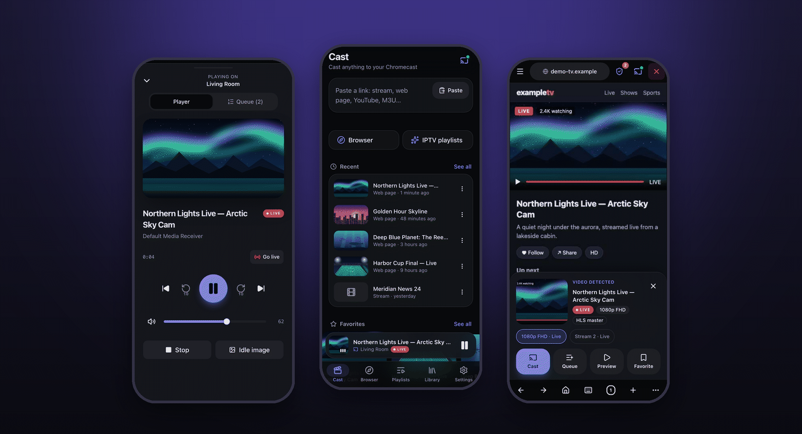
</p>

## Contents

[Features](#features) · [Screenshots](#screenshots) · [How it works](#how-it-works) · [Quick start](#quick-start) ·
[Configuration](#configuration) · [Usage tips](#usage-tips) · [Security](#security) ·
[Troubleshooting](#faq--troubleshooting) · [Limitations](#known-limitations) · [Development](#development) · [Acknowledgements](#acknowledgements)

## Features

**Cast almost anything**
- Direct links: HLS (`.m3u8`), DASH (`.mpd`), MP4, MKV, MPEG-TS, live or on demand.
- **Web pages** with a video inside: opened in a real Chromium on the server (JavaScript, nested iframes,
  "play" clicks) and the stream is caught at the network level.
- **IPTV / M3U playlists**: import by URL or file, groups, search, thousands of channels, per-channel headers.
- **YouTube and many other sites** through [yt-dlp](https://github.com/yt-dlp/yt-dlp).
- **Local files** from a folder on the server, with their `.srt` / `.vtt` subtitles.

**Remote browser**
- Browse any site from your phone: tap, scroll, type. Detected streams slide up in a panel with a thumbnail,
  quality (*1080p FHD*) and a *Live* badge — **Cast**, **Queue**, **Preview** or **Favorite** in one tap.
- **Ad blocking like uBlock Origin**: Brave's `adblock` engine with uBO's default lists, cosmetic filters,
  a per-site switch and a blocked-requests counter.
- **Popups held back**: *"The page wants to open …"* → Open / Block / Always block. One tap on × closes everything.

**A real remote**
- Play/pause, seek, ±10 s, *Go live*, volume, subtitles and audio tracks, previous/next.
- Server-side **queue** (reorder, remove), **favorites**, **history**, an **idle image** on the TV.
- Every open phone, tablet and PC stays **in sync in real time** over WebSocket.

**Plays what the Chromecast can't**
- Built-in **proxy** for streams that need a Referer, Cookie, User-Agent or CORS headers.
- **FFmpeg restream** for raw TS, RTMP/RTSP/UDP, AVI, FLV, WMV…; non-H.264 video is transcoded on the fly.

**Made for home**
- Installable **PWA**, dark and light themes, English and Italian.
- Automatic discovery (mDNS) or **add a device by IP**; one multi-arch Docker image (`amd64`, `arm64`).

## Screenshots

<table>
  <tr>
    <td align="center">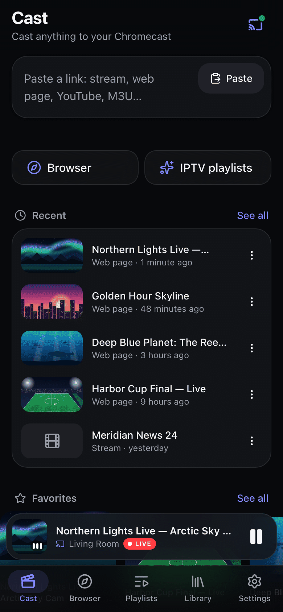<br><sub>Home</sub></td>
    <td align="center">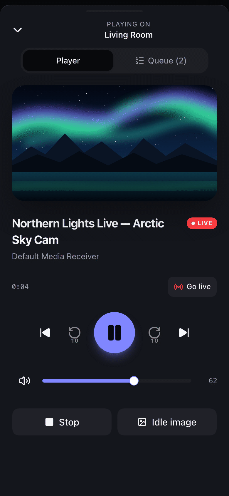<br><sub>Now Playing</sub></td>
    <td align="center">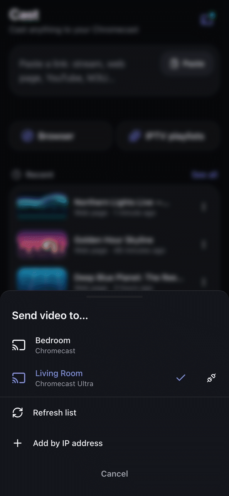<br><sub>Send video to…</sub></td>
    <td align="center">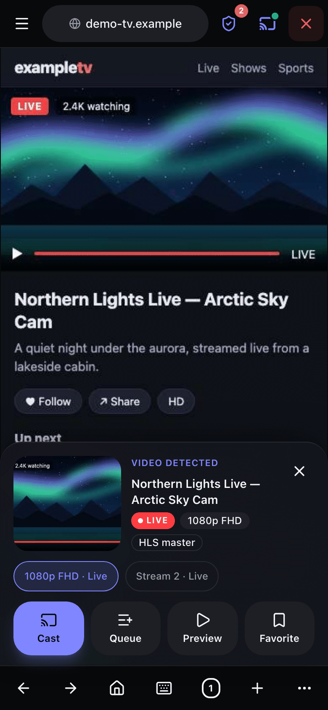<br><sub>Remote browser: video detected</sub></td>
  </tr>
  <tr>
    <td align="center">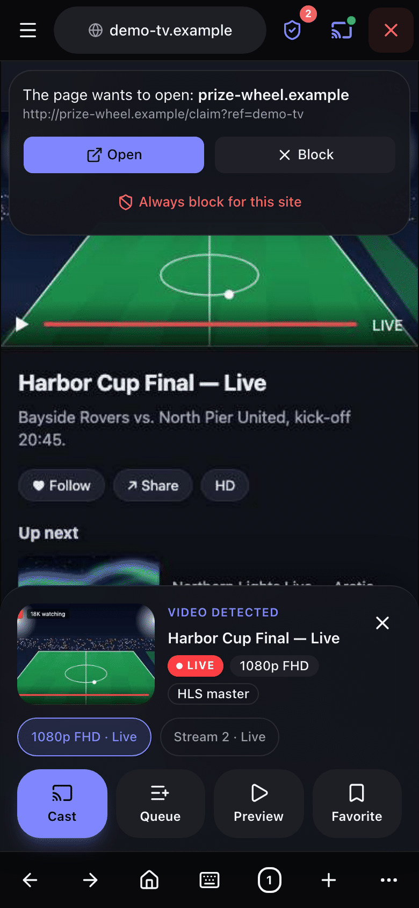<br><sub>Popup held back</sub></td>
    <td align="center">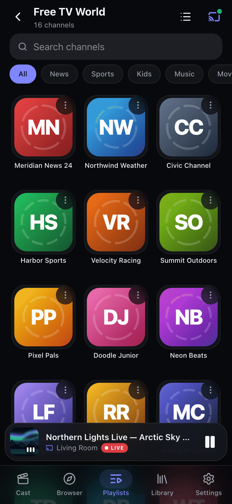<br><sub>IPTV channels</sub></td>
    <td align="center">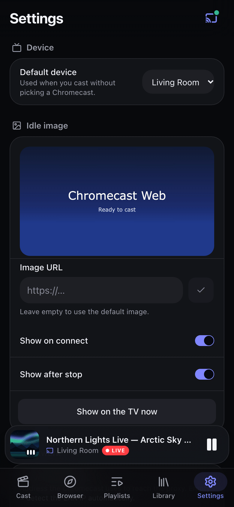<br><sub>Settings</sub></td>
    <td align="center">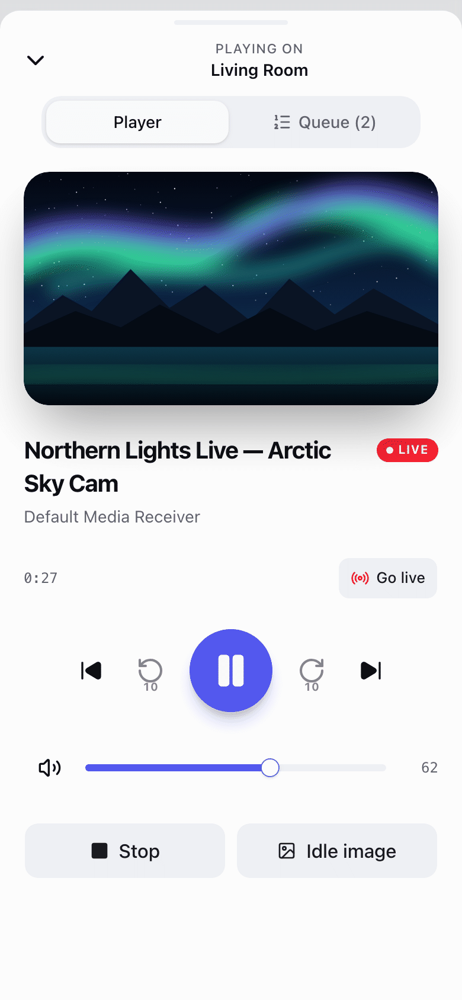<br><sub>Light theme</sub></td>
  </tr>
</table>

<details>
<summary><b>Desktop</b></summary>

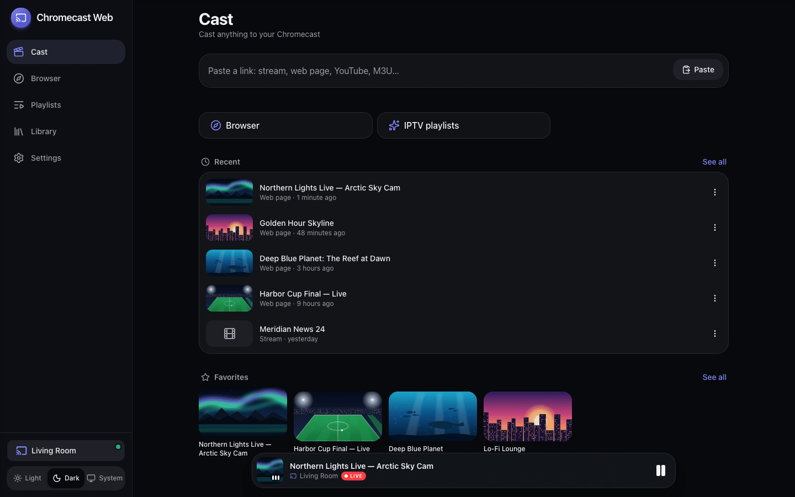
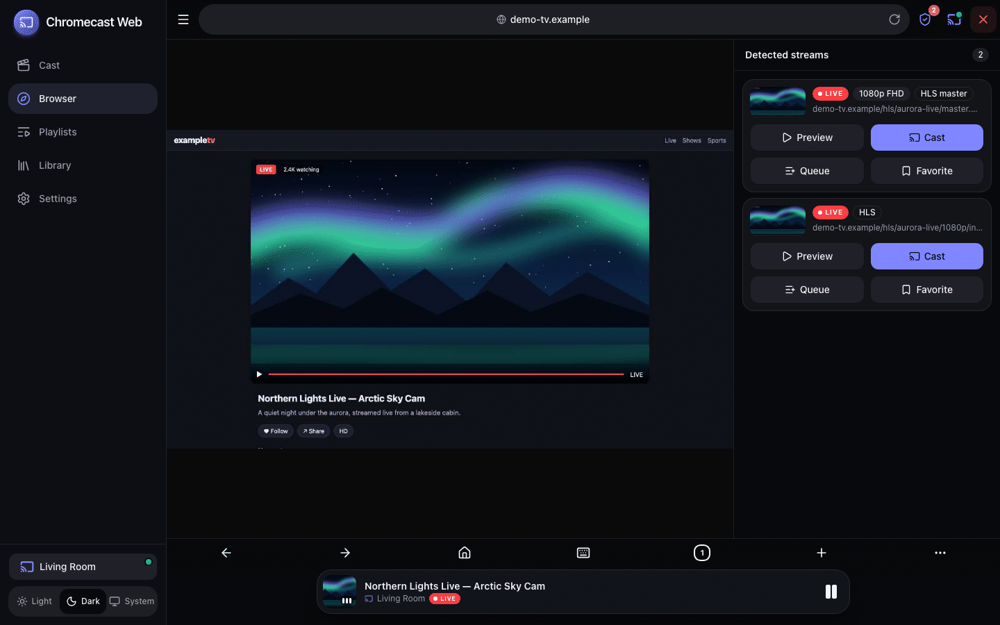

</details>

<sub>Screenshots use fictional demo data (made-up channels, original artwork) generated by `make screenshots`.</sub>

## How it works

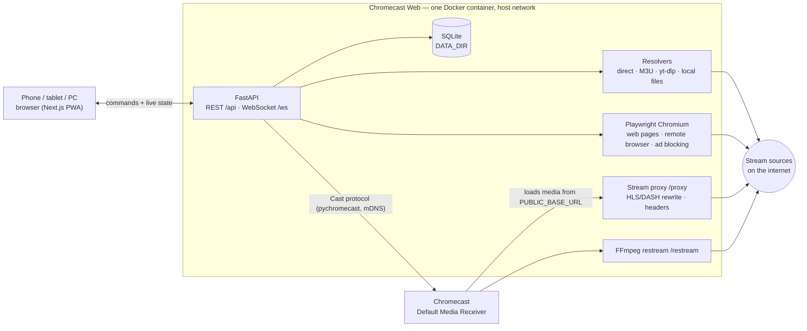

1. The phone talks to the server only (REST for commands, a WebSocket that pushes every state change).
2. The server resolves your input into a playable stream: directly, via yt-dlp, by parsing an M3U, or by opening the
   page in Chromium and sniffing its network traffic.
3. It tells the Chromecast what to load. When the stream needs headers, has CORS issues or uses a format the
   Chromecast can't play, the Chromecast loads it **from the server** (`/proxy` or `/restream`) instead — which is
   why the server must be reachable from the Chromecast on your LAN.

The full contract (models, endpoints, WebSocket messages) lives in [`docs/ARCHITECTURE.md`](docs/ARCHITECTURE.md).

## Quick start

> **Requirement:** the server and the Chromecast must be on the **same LAN**. mDNS discovery doesn't cross Docker's
> bridge network, and the Chromecast must be able to open `http://<server-ip>:8000/proxy/…`.

### Docker / Coolify (recommended)

The repository ships a [`docker-compose.yml`](docker-compose.yml) with `network_mode: host` (required) and a volume
for `/data`.

```bash
git clone https://github.com/Filpin011/Chromecast-Web.git
cd Chromecast-Web
PUBLIC_BASE_URL=http://192.168.1.10:8000 docker compose up -d --build   # your server's LAN IP
```

Then open `http://192.168.1.10:8000` on your phone and *Add to Home Screen*.

**Coolify**: *New Resource → Docker Compose* pointing at this repository (it uses `docker-compose.yml`). Set
`PUBLIC_BASE_URL` in the environment variables. With host networking the app listens directly on port `8000` of the
server: don't attach a public domain — if you want a name, use one that only resolves on your LAN/VPN.

**Prebuilt image**: each release publishes `ghcr.io/filpin011/chromecast-web:latest` (and `:X.Y.Z`) for
`linux/amd64` and `linux/arm64`. In `docker-compose.yml`, remove the `build:` block and set
`image: ghcr.io/filpin011/chromecast-web:latest`.

<details>
<summary>Plain <code>docker run</code></summary>

```bash
docker run -d --name chromecast-web --network host --shm-size 1g \
  -e PUBLIC_BASE_URL=http://192.168.1.10:8000 \
  -v chromecast-web-data:/data \
  ghcr.io/filpin011/chromecast-web:latest
```

Optional local media: add `-v /path/to/Media:/media:ro -e MEDIA_ROOT=/media`.
</details>

The image contains the static frontend, Python 3.12, FFmpeg, Chromium (Playwright) and yt-dlp with its JavaScript
runtime; it runs as a non-root user and has a health check on `GET /api/health`.

### Native (macOS / Linux)

Requirements: Python 3.12+, Node 24+, `ffmpeg` on the `PATH`, `make`.

```bash
make setup        # backend/.venv + frontend node_modules
make browsers     # Playwright Chromium (web pages, remote browser)
CAST_DRIVER=pychromecast make serve   # builds the frontend and serves everything on :8000
```

`make serve` defaults to the **fake** Chromecast driver, so `CAST_DRIVER=pychromecast` is what talks to real
devices. Want to look around without a Chromecast? `make demo` starts the fake driver with demo data on
http://localhost:8000. `make help` lists every target.

**From your phone**: the startup log prints the URL the Chromecast will use (`started (… base url=http://<lan-ip>:8000)`);
open that same address on the phone. Add `MEDIA_ROOT=~/Movies` to cast local files (subtitles next to a video —
`Film.srt`, `Film.it.vtt` — are attached automatically). On macOS, allow the two system prompts the first run
triggers: *Accept incoming network connections* (firewall, so the phone and the Chromecast can reach the server) and
*Find devices on local networks* for your terminal app (macOS 15+, needed for discovery and for talking to the
Chromecast; *System Settings → Privacy & Security → Local Network* if you dismissed it). Keep the Mac awake while
casting through the proxy.

## Configuration

Environment variables of the backend (also read from a `.env` file in the working directory). Everything else —
default device, idle image, force proxy, ad blocking, popup policy — is set in the app, under **Settings**.

| Variable | Default | Description |
|---|---|---|
| `PUBLIC_BASE_URL` | auto: LAN IP + `PORT` | URL **the Chromecast** uses to reach the server (e.g. `http://192.168.1.10:8000`). Set it when auto-detection picks the wrong interface (VPN, Docker, several NICs). Can be overridden in *Settings → Network*. |
| `PORT` | `8000` | HTTP port. |
| `HOST` | `0.0.0.0` | Bind address. |
| `CAST_DRIVER` | `pychromecast` | `fake` simulates two devices (development, demos, tests). |
| `DATA_DIR` | `./data` (image: `/data`) | SQLite database, filter lists, restream temp files. |
| `MEDIA_ROOT` | unset | Folder for the *Files* section; disabled when unset. |
| `FRONTEND_DIR` | `../frontend/out` (image: `/app/frontend`) | Static export served at `/`. |
| `ENABLE_PLAYWRIGHT` | `true` | Web-page extraction and the remote browser (headless Chromium). |
| `FILTERS_AUTO_UPDATE` | `true` | Download/refresh uBlock Origin's default lists every 24 h; `false` = bundled fallback list only. |
| `LOG_LEVEL` | `info` | `debug`, `info`, `warning`, `error`. |
| `FFMPEG_PATH` | `ffmpeg` | FFmpeg binary used by `/restream`. |
| `FFPROBE_PATH` | `ffprobe` next to `FFMPEG_PATH` | FFprobe binary (codec detection). |
| `BROWSER_MAX_SESSIONS` | `2` | Concurrent remote-browser sessions. |
| `BROWSER_IDLE_TIMEOUT` | `600` | Seconds before an unwatched remote-browser session is closed. |
| `WEBPAGE_TIMEOUT` | `20` | Seconds spent looking for a stream in a web page. |
| `RESTREAM_IDLE_TIMEOUT` | `60` | Seconds without requests before an FFmpeg job is cleaned up. |
| `DISCOVERY_SECONDS` | `5` | Length of an mDNS discovery scan. |
| `TICK_INTERVAL` | `1.0` | Seconds between state broadcasts while something plays. |
| `CORS_ORIGINS` | `http://localhost:3000,http://127.0.0.1:3000` | Development only (Next dev server); production is same-origin. |
| `CORS_ORIGIN_REGEX` | private-LAN hosts | Development only, so `make dev` works from a phone; `""` disables it. |
| `FAKE_DELAY` | `0.4` | Simulated latency of the fake driver. |

## Usage tips

- **What to paste**: a stream URL, a web page, a YouTube link, an M3U URL — the Home field detects the kind. If a
  page needs clicks (cookie banners, "play" overlays), the error card offers **Open in the interactive browser**.
- **Remote browser**: choose the *Mobile* or *Desktop* mode; the page is drawn 1:1 on your screen. The keyboard button
  sends text to the page. When a stream is detected, pick the best one in the panel (the highest quality and HLS
  masters come first; ads and short pre-rolls are ranked last).
- **Ad blocking**: the shield in the top bar shows how many requests were blocked and turns blocking off for the
  current site. Lists refresh every 24 h (*Settings → Browser & ads*).
- **Popups**: the default policy is *Ask*; switch to *Block* or *Allow* in Settings. *Always block for this site*
  remembers the site that opened it. The red × closes the session immediately.
- **IPTV headers**: channels that need headers keep working when they're declared in the playlist —
  `#EXTVLCOPT:http-referrer=…` / `http-user-agent=…`, `#EXTHTTP:{"Referer":"…"}`, `user-agent="…"` in `#EXTINF`, or
  Kodi-style `url|Referer=…&User-Agent=…`. Pasted URLs accept the Kodi syntax too.
- **Picky streams**: turn on *Settings → Network → Force proxy* when a stream plays in the app preview but not on
  the TV.

## Security

Chromecast Web has **no authentication**: anyone who can open the page controls your Chromecast, can browse
`MEDIA_ROOT` and can make the server fetch arbitrary URLs (proxy, yt-dlp, remote browser). Run it **only on your
home LAN or behind a VPN**: no port forwarding, no public reverse proxy, no public Coolify domain. Report
vulnerabilities privately as described in [SECURITY.md](SECURITY.md).

## FAQ / Troubleshooting

<details>
<summary><b>No devices found</b></summary>

- Docker: the container must use **`network_mode: host`** (`--network host`); mDNS doesn't cross the bridge network.
- The server and the Chromecast must be on the same subnet/VLAN; some routers block multicast between Wi-Fi and
  Ethernet or on guest networks.
- Tap **Refresh list** in *Send video to…*, or use **Add by IP address** (find the IP in your router or in the
  Google Home app).
</details>

<details>
<summary><b>The Chromecast shows an error or keeps loading</b></summary>

- The Chromecast must reach the server: open `PUBLIC_BASE_URL` + `/api/health` from another device on the LAN.
  Fix `PUBLIC_BASE_URL` if it shows a VPN/Docker address, and allow the port in the server's firewall.
- Enable **Force proxy** for streams that need a Referer/Cookie or lack CORS headers.
- Formats the Chromecast can't decode (raw TS, RTMP, AVI, MPEG-2, Xvid…) go through `/restream`: make sure
  `ffmpeg` works on the server (it's included in the Docker image). Transcoding needs some CPU.
</details>

<details>
<summary><b>A web page says "no stream found"</b></summary>

Open it in the **remote browser**, click through the page as you would on a PC and wait for the *Video detected*
panel. Some sites need the play button pressed, or a popup dismissed, before the player requests the stream.
</details>

<details>
<summary><b>YouTube or another site stopped working</b></summary>

Sites change often: update to the latest release (which bumps yt-dlp). The Docker image includes the JavaScript
runtime yt-dlp needs for YouTube.
</details>

## Known limitations

- So far tested end-to-end only with the fake driver: the first run against a real Chromecast still has to happen
  at home — please report what you find.
- Files that need converting (local or HTTP `.avi`, `.ts`, `.wmv`…) are converted in real time into an HLS `EVENT`
  playlist: they start from the beginning, but seeking forward only reaches as far as FFmpeg has got; non-H.264
  video (Xvid/DivX, MPEG-2, WMV) is re-encoded and needs server CPU.
- DASH manifests are rewritten and cast through `/proxy` when needed; the in-app preview supports HLS and MP4 only
  (DASH can still be cast).
- Cosmetic filters yes, uBlock Origin *scriptlets* no.
- Haptic feedback on Android only (iOS Safari ignores the Vibration API).

## Development

**Contract first**: [`docs/ARCHITECTURE.md`](docs/ARCHITECTURE.md) is the single source of truth for models,
endpoints and WebSocket messages; change it first, then `backend/app/models` and `frontend/src/lib/api` together.

```bash
make dev           # fake Chromecast backend on :8000 + Next dev server on :3000 (open it from your phone too)
make test          # every check: pytest + ruff, typecheck + eslint + vitest + static build
make test-browser  # only the real-Chromium integration tests
make demo          # fake driver + fictional demo data on :8000
make screenshots   # regenerate docs/screenshots and docs/assets/hero.png
make brand         # re-render icons, favicon and social preview from docs/assets/icon*.svg
```

| Path | What |
|---|---|
| `backend/` | FastAPI app (Python 3.12+), pytest suite in `tests/` (no network or Chromecast needed: fake driver, mocked HTTP) |
| `backend/scripts/` | demo server, screenshot and icon renderers |
| `frontend/` | Next.js App Router static export, TypeScript, Tailwind CSS v4, shadcn/ui, vitest ([notes](frontend/README.md)) |
| `docs/` | architecture contract, icon sources, screenshots |

`CAST_DRIVER=fake` simulates two devices with realistic state changes, so the whole UI works without hardware.
Tests marked `@pytest.mark.browser` drive a real Chromium against a local fixture site and are skipped when it isn't
installed (`make browsers`).

## Contributing, security, license

- [CONTRIBUTING.md](CONTRIBUTING.md) — workflow, Conventional Commits, releases, local setup.
- [SECURITY.md](SECURITY.md) — report vulnerabilities privately.
- [DISCLAIMER.md](DISCLAIMER.md) — trademarks and no-warranty notice.
- [CHANGELOG.md](CHANGELOG.md) · License: [MIT](LICENSE).

## Acknowledgements

Built on the shoulders of
[pychromecast](https://github.com/home-assistant-libs/pychromecast),
[Playwright](https://playwright.dev),
[yt-dlp](https://github.com/yt-dlp/yt-dlp),
[FFmpeg](https://ffmpeg.org),
Brave's [adblock-rust](https://github.com/brave/adblock-rust),
the [uBlock Origin](https://github.com/gorhill/uBlock) filter lists (and EasyList, EasyPrivacy, Peter Lowe's list,
EasyList Italy),
[FastAPI](https://fastapi.tiangolo.com),
[Next.js](https://nextjs.org) and
[shadcn/ui](https://ui.shadcn.com).
