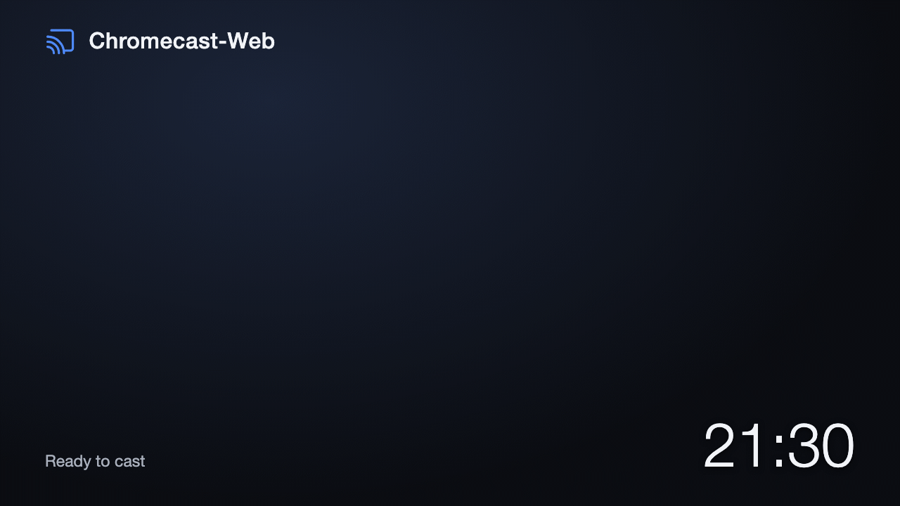
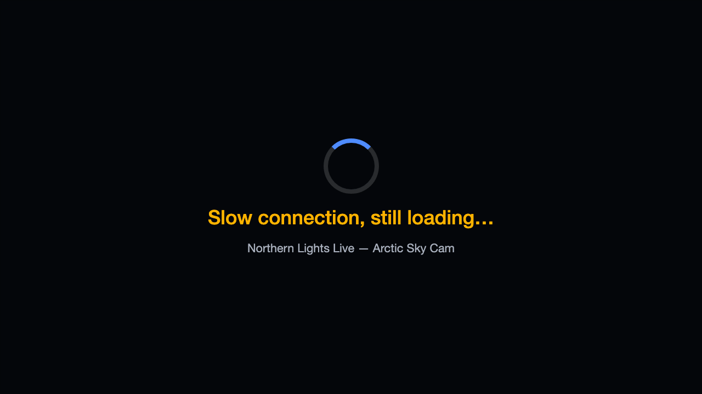
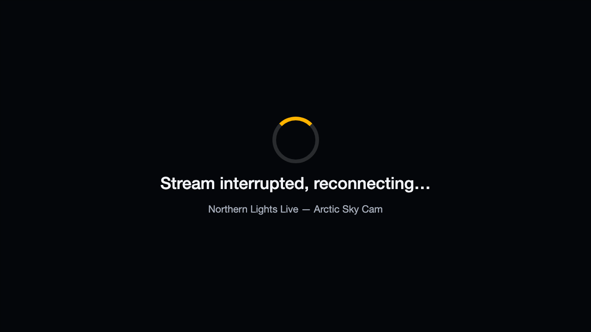

# Custom Cast receiver (optional)

> **Italiano in breve** — Chromecast-Web può usare un "receiver" personalizzato al posto del
> Default Media Receiver di Google: schermata di caricamento chiara ("Caricamento…",
> "Connessione lenta…"), messaggio "Flusso interrotto, riconnessione…" invece dello schermo nero,
> overlay con titolo, copertina, badge LIVE e barra di avanzamento, schermata di attesa con orologio,
> e un buffer più tollerante per le dirette HLS instabili. Richiede una registrazione una tantum
> (5 US$) nella Google Cast SDK Developer Console e la registrazione del numero di serie del tuo
> Chromecast. I passaggi sono qui sotto, con le voci della console in inglese come appaiono.
> Se `CAST_APP_ID` non è impostata, tutto funziona esattamente come prima.

Without configuration Chromecast-Web LOADs every stream into Google's **Default Media Receiver**
(app id `CC1AD845`). Setting `CAST_APP_ID` switches every LOAD to your own receiver app instead,
whose page is served by Chromecast-Web itself at **`/receiver/`** (`backend/app/static/receiver/`:
plain HTML/CSS/JS, no build step, Google's CAF SDK loaded from `www.gstatic.com`).

## What the receiver adds

| | Default Media Receiver | Custom receiver |
|---|---|---|
| Loading | small spinner | big spinner + "Loading…" / "Caricamento…", after 5 s of buffering "Slow connection, still loading…" / "Connessione lenta, caricamento in corso…" |
| Playback error | black screen / back to the backdrop | "Stream interrupted, reconnecting…" / "Flusso interrotto, riconnessione…" until the server's next LOAD (the backend re-LOADs live streams after an error; the receiver never reloads on its own). After 60 s without a new LOAD it falls back to the idle screen. |
| Overlay | Google's | title, artwork, LIVE badge for live streams, progress bar + times for VOD; shown on start / pause / seek, auto-hidden after 5 s while playing |
| Idle | Google's backdrop | app name + clock; the idle image (Settings → idle image) is shown full screen with the clock |
| Flaky live HLS | CAF defaults | larger resume buffer, more segment retries, explicit request timeouts (below) |

  
  
  

The TV text language follows the device's `navigator.language` (Italian when it starts with `it`,
English otherwise). The LOAD semantics stay those of the Default Media Receiver: the backend sends
the same LOAD (`hlsSegmentFormat`, `hlsVideoSegmentFormat`, subtitle `tracks`, `textTrackStyle`,
no `currentTime` on live = live edge); CAF reads these fields natively, and a LOAD interceptor also
accepts the two HLS format fields from `customData`. HLS stays on CAF's default player (no
`useShakaForHls`), the same one the Default Media Receiver uses for these LOADs.

### Playback settings

Tunables at the top of `backend/app/static/receiver/receiver.js`:

| Setting | Value | CAF field | Why |
|---|---|---|---|
| `AUTO_RESUME_SECONDS` | `8` | `PlaybackConfig.autoResumeDuration` | seconds buffered before playback (re)starts after a stall: fewer start/stop cycles on a slow link |
| `SEGMENT_RETRY_LIMIT` | `6` | `PlaybackConfig.segmentRequestRetryLimit` | retries of a failed segment (CAF default: 3), so one stalled segment does not end a live stream |
| `MANIFEST_TIMEOUT_MS` | `10000` | `manifestRequestHandler` → `NetworkRequestInfo.timeoutInterval` | per-request timeout of a playlist |
| `SEGMENT_TIMEOUT_MS` | `15000` | `segmentRequestHandler` → `NetworkRequestInfo.timeoutInterval` | per-request timeout of a segment |

Field reference: [PlaybackConfig](https://developers.google.com/cast/docs/reference/web_receiver/cast.framework.PlaybackConfig),
[NetworkRequestInfo](https://developers.google.com/cast/docs/reference/web_receiver/cast.framework.NetworkRequestInfo).
Larger values make a stall recover more often but take longer to give up (and to show the error screen).

## What Google's documentation says (read before paying)

From [Registration](https://developers.google.com/cast/docs/registration) (Google Cast SDK Developer Console):

- **Cost**: "The $5 developer account registration fee is non-refundable." It is a one-time account fee.
- **Unpublished apps run only on registered devices**: to "gain access to your unpublished Web
  Receiver app during development, you must register the device with your app" (by serial number).
  After adding the device: "Wait fifteen minutes before continuing", then "Restart your Cast device:
  disconnect the power or USB cable from the device, then reconnect it."
- **HTTP vs HTTPS for the receiver URL**: "During development, the URL can use HTTP but when the app
  is published it has to use HTTPS." It's "okay for your Web Receiver to be on an internal
  (NAT-registered) IP address, but not on localhost".
- **Media over HTTP**: the same page says that even when the receiver is served over HTTPS, "the
  content loaded on the Web Receiver app may be served over HTTP".
- **Edits**: "Edits take effect only after you publish or republish the app."
- **Styled Media Receiver** (alternative): the Default Media Receiver with your own CSS ("Skin URL",
  which must be HTTPS). It only restyles Google's player; it cannot add the reconnecting screen or
  change the playback/buffer settings, so Chromecast-Web does not use it.

From [Web Receiver basics](https://developers.google.com/cast/docs/web_receiver/basic): "Published
Web Receiver apps must be hosted on TLS-capable servers"; always load the SDK from `gstatic.com`
(the protocol-relative `//www.gstatic.com/...` URL follows the page's own scheme, so HTTP during
development is transparent).

**What this means for a home LAN install**: keep the app **unpublished** and enter the plain
`http://` LAN URL of your server. That is allowed for development apps, needs no certificate, and
the receiver page then has the same origin as `/proxy`, `/restream` and `/local` (no mixed content,
no CORS for proxied media). Publishing would require an HTTPS receiver URL and is not needed for
your own devices. Serving the receiver over HTTPS while it loads `http://` LAN media is what
Google's sentence above covers; it is not a setup this project uses or has tested.
The backend side is covered by unit tests; the receiver page itself has not yet been
verified on a real Chromecast, so report anything odd (see Remote debugging).

The UI uses CAF's documented [custom UI data binding](https://developers.google.com/cast/docs/web_receiver/customize_ui)
(a `<video class="castMediaElement">` driven by `PlayerManager`, no `cast-media-player`): the
`cast-media-player` element can only be restyled with CSS variables, its built-in overlay cannot be
replaced.

## Step by step / Passo per passo

1. **Give the server a stable address** (DHCP reservation on the router, e.g. `192.168.1.10`).
   The receiver URL is stored in Google's console, so it must not change. Use the IP (or a DNS name
   your router resolves), not `localhost` and not a `.local` mDNS name.
2. **Check the URL** from a phone/PC on the same Wi-Fi: open `http://192.168.1.10:8000/receiver/`.
   You should see the dark page with the app name and the clock (the CAF SDK errors in a normal
   browser are expected). Note the **trailing slash**.
3. **Register as a Cast developer** at <https://cast.google.com/publish> (Google Cast SDK Developer
   Console) and pay the one-time US$5 fee. / *Registrati come sviluppatore Cast e paga 5 US$ una tantum.*
4. **Add the application**: *Add New Application* → **Custom Receiver** → Name `Chromecast-Web`,
   URL `http://192.168.1.10:8000/receiver/` (your `PUBLIC_BASE_URL` + `/receiver/`), leave the two
   checkboxes unticked → *Save*. Copy the **Application ID** (8 characters, e.g. `ABCD1234`).
   **Do not publish** the app.
5. **Register the Chromecast**: *Devices* → *Add New Device* → serial number + a description.
   The Chromecast Ultra's serial number is printed on the device / its box and is shown in the Google
   Home app (device → Settings → Device information). / *Il numero di serie è sul dispositivo, sulla
   scatola o nell'app Google Home (Impostazioni → Informazioni sul dispositivo).*
6. **Wait ~15 minutes** until the device shows "Ready for Testing", then **reboot the Chromecast**
   by unplugging its power and plugging it back in. / *Attendi 15 minuti, poi stacca e riattacca
   l'alimentazione del Chromecast.*
7. **Configure Chromecast-Web**: set `CAST_APP_ID=ABCD1234` (Coolify: *Environment Variables*;
   Docker Compose: `environment:`; native: `.env`) and restart the server. The log shows
   `cast receiver app_id=ABCD1234 (Chromecast-Web Receiver)` at startup.
8. **Cast something.** The TV now shows the custom receiver. Unset `CAST_APP_ID` (and restart) to go
   back to the Default Media Receiver at any time.

## Troubleshooting / Problemi comuni

| Symptom | Likely cause / fix |
|---|---|
| "Could not start the Chromecast-Web Receiver on the Chromecast" | the device is not (yet) registered for the app: check *Ready for Testing*, wait the 15 minutes, **reboot** the Chromecast. Unregistered devices cannot launch unpublished apps. |
| The app launches but stays on a black/blank screen | the Chromecast cannot load the receiver URL: wrong IP/port, missing trailing slash, server restarted on another IP, firewall. Open the URL from another device on the same network. |
| Still black after changing the URL in the console | edits may need time to propagate ("Edits take effect only after you publish or republish the app"); wait, reboot the Chromecast, or create a new app id with the right URL. |
| Works with the Default Media Receiver but not here | compare the server log (`LOAD ...` line) with the receiver console (`receiver load ...`, see debugging below). |
| Wrong language on the TV | it follows the Chromecast's system language (set via Google Home). |

## Remote debugging

For registered development devices the receiver can be inspected with Chrome DevTools
([Remote debugger](https://developers.google.com/cast/docs/debugging/remote_debugger)): the
application and the device "must be registered to the same developer account".

1. Start a cast session first (cast anything from Chromecast-Web).
2. On a computer on the same network open `chrome://inspect` and click *Inspect* under the
   Chromecast, or open `http://<chromecast-ip>:9222` directly (the IP is in Google Home → device
   → Settings → Device information) and click *Remote Debugging*.
3. The console shows one line per receiver event, e.g. `receiver load contentType=... streamType=LIVE
   hlsSegmentFormat=fmp4 ...`, `receiver state from=playing to=loading why=buffering`,
   `receiver error detailedErrorCode=...`.

Google notes that some 2nd/3rd generation Chromecasts on firmware 1.49 may not be debuggable, that
leaving the debugger attached for a long time can cause failures, and that if the debugger page stays
empty you can set *Insecure content* to *Allow* in Chrome's site settings.
